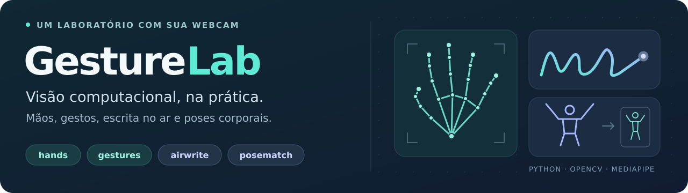

# GestureLab



[](https://github.com/luigiscofano/gesturelab/actions/workflows/ci.yml)
[](docs/INSTALACAO.md)
[](LICENSE)

**Transforme sua webcam em um laboratório de visão computacional.** Detecte mãos,
reconheça gestos, desenhe com o indicador e encontre imagens com uma pose corporal
parecida. Quatro modos independentes, feitos em Python com OpenCV e MediaPipe Tasks.

**[Começar](docs/INSTALACAO.md)** · **[Como usar](docs/USO.md)** ·
**[Documentação](docs/README.md)** · **[Mapa do código](docs/MAPA_DO_PROJETO.md)** ·
**[Preciso de ajuda](docs/SOLUCAO_DE_PROBLEMAS.md)**

O aplicativo roda localmente e abre uma janela no seu computador. Esta página
reúne o código, os guias e o histórico do projeto.

## O que você pode fazer

| Modo | Experiência | Explore |
| --- | --- | --- |
| **Mãos** · `hands` | Veja 21 pontos e as conexões de cada mão, com até duas mãos por padrão. | [Usar o rastreamento](docs/USO.md#mãos--hands) |
| **Gestos** · `gestures` | Faça um dos sete gestos conhecidos e veja seu nome em português. | [Conhecer os gestos](docs/USO.md#gestos--gestures) |
| **Escrita no ar** · `airwrite` | Use o indicador como caneta, desfaça traços e salve o desenho em PNG + JSON. | [Aprender os controles](docs/USO.md#escrita-no-ar--airwrite) |
| **Poses parecidas** · `posematch` | Compare sua pose com um catálogo local e veja a referência aceita mais próxima. | [Experimentar o PoseMatch](docs/USO.md#poses-parecidas--posematch) |

### Uma prévia do PoseMatch


*Prévia ilustrativa gerada com pontos sintéticos e uma imagem original do catálogo.
Mostra a interface; não é uma captura de webcam nem uma medição do modelo.*

O catálogo inicial tem **12 ilustrações de poses humanas**. Você pode acrescentar
suas próprias fotografias seguindo o [guia do catálogo](pose_gallery/README.md).

## Execute pela primeira vez

Tenha **Python 3.12 de 64 bits**, Git e uma webcam. No **PowerShell do Windows**:

```powershell
git clone https://github.com/luigiscofano/gesturelab.git
cd gesturelab
py -3.12 -m venv .venv
.\.venv\Scripts\python.exe -m pip install --upgrade pip
.\.venv\Scripts\python.exe -m pip install -r requirements.txt
.\.venv\Scripts\python.exe scripts/download_models.py
.\.venv\Scripts\python.exe scripts/check_environment.py --imports --models all
.\.venv\Scripts\python.exe app.py --mode hands
```

Uma janela deve mostrar sua câmera. Mostre as mãos para ver os pontos e as conexões.
Clique na janela e pressione **Q** ou **Esc** para sair.

**[Instalação explicada passo a passo](docs/INSTALACAO.md)** inclui os programas
necessários, a opção de baixar ZIP, os comandos de macOS/Linux e como atualizar.
Se algo falhar, vá direto à [solução de problemas](docs/SOLUCAO_DE_PROBLEMAS.md).

Depois, escolha uma linha por vez:

```powershell
.\.venv\Scripts\python.exe app.py --mode gestures
.\.venv\Scripts\python.exe app.py --mode airwrite
.\.venv\Scripts\python.exe app.py --mode posematch
```

Na escrita, **S salva** o desenho antes de sair. Os arquivos vão para `outputs/`.
Para trocar de modo, feche a janela atual e execute o próximo comando.
O [guia de uso](docs/USO.md) reúne os atalhos, as opções e os exemplos com fotografias.

## Encontre o que você precisa

| Seu objetivo | Caminho recomendado |
| --- | --- |
| **Executar e explorar** | [Instalação](docs/INSTALACAO.md) → [Modos e comandos](docs/USO.md) |
| **Entender o funcionamento** | [Mapa do projeto](docs/MAPA_DO_PROJETO.md) → [Arquitetura](docs/ARQUITETURA.md) |
| **Estudar visão computacional** | [Guia completo, com sumário por assunto](docs/GUIA_COMPLETO.md) |
| **Resolver um erro** | [Diagnóstico por sintoma](docs/SOLUCAO_DE_PROBLEMAS.md) → [Relatar um problema](https://github.com/luigiscofano/gesturelab/issues/new/choose) |
| **Verificar qualidade e resultados** | [Testes](tests/README.md) → [Validação registrada](docs/VALIDACAO.md) |
| **Evoluir ou contribuir** | [Roadmap](docs/ROADMAP.md) → [Como contribuir](CONTRIBUTING.md) |
| **Apresentar no portfólio** | [Roteiro de apresentação](docs/GUIA_COMPLETO.md#16-transformar-em-uma-peça-de-portfólio) → [Registrar um experimento](docs/EXPERIMENTOS.md) |

**[Abrir a central de documentação →](docs/README.md)**

## Como funciona

O OpenCV lê a webcam ou uma foto. A imagem passa de BGR para RGB e segue para
**um modelo MediaPipe por execução**. O modo escolhido transforma os pontos
detectados em conexões, rótulos, traços ou uma comparação com o catálogo.

| Tecnologia | Papel no projeto |
| --- | --- |
| Python | Regras, estado da caneta, comparação de poses e comandos |
| OpenCV | Câmera, leitura de imagens, desenho e janela |
| MediaPipe Tasks | Modelos prontos para mãos, gestos e corpo |
| NumPy | Representação e manipulação das imagens |
| pytest e Ruff | Testes, análise de código e formatação |

A inferência usa a imagem original; o espelhamento é aplicado à visualização.
A escrita guarda traços separados. O PoseMatch normaliza a geometria do corpo
antes de comparar referências. A [arquitetura](docs/ARQUITETURA.md) detalha essas
decisões e o [mapa do projeto](docs/MAPA_DO_PROJETO.md) mostra onde encontrá-las no código.

## Estado do projeto

Os quatro modos estão implementados. Há testes automatizados, inferência com
imagens registrada e verificações em Windows/Ubuntu no GitHub Actions. A webcam
e a interface precisam ser validadas no equipamento em que você vai demonstrar.

| Disponível hoje | Próximas evoluções |
| --- | --- |
| Landmarks de mãos e gestos de um modelo pronto | Gestos personalizados e rótulos mais estáveis |
| Escrita com suavização e exportação | Reconhecer os caracteres desenhados |
| Comparação corporal com referências locais | Ampliar o catálogo e medir a qualidade da busca |
| Aplicação de desktop e processamento de foto | Interface de seleção de modos e demo no navegador |

A busca de poses usa **o catálogo local**; a escrita produz **desenhos**; os gestos
reconhecidos são **classes predefinidas**. Pontuações e distâncias não representam
acurácia medida. Consulte [validação](docs/VALIDACAO.md) e [roadmap](docs/ROADMAP.md)
para acompanhar o que foi verificado e o que ainda será desenvolvido.

## Testar e contribuir

Com o ambiente criado, instale as dependências de desenvolvimento e execute:

```powershell
.\.venv\Scripts\python.exe -m pip install -r requirements-dev.txt
.\.venv\Scripts\python.exe -m ruff format --check .
.\.venv\Scripts\python.exe -m ruff check .
.\.venv\Scripts\python.exe -m pytest -q
```

Os testes de lógica não precisam de webcam nem de pesos. O
[README de testes](tests/README.md) explica a cobertura; o
[guia de contribuição](CONTRIBUTING.md) explica branches, commits e pull requests.
As mudanças já integradas estão no [changelog](CHANGELOG.md), e a configuração
do GitHub está documentada em [Automação e colaboração](.github/AUTOMACAO.md).

## Autoria e licença

Projeto de **Luigi Scofano de Araujo**, desenvolvido com assistência de IA e
modelos pré-treinados do MediaPipe. O código próprio é distribuído sob a
[licença MIT](LICENSE). Bibliotecas, modelos e imagens mantêm suas próprias
condições de uso; consulte [referências e créditos](THIRD_PARTY_NOTICES.md).

[Voltar ao início](#gesturelab) · [Explorar a documentação](docs/README.md) ·
[Ver o histórico](https://github.com/luigiscofano/gesturelab/pulls?q=is%3Apr+is%3Amerged)
