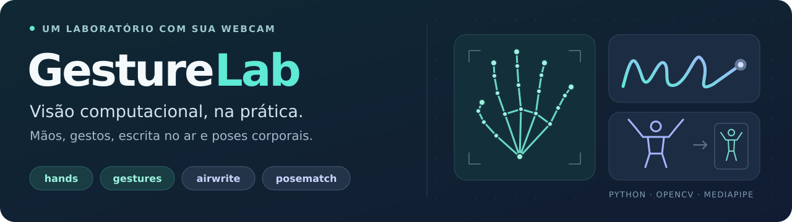
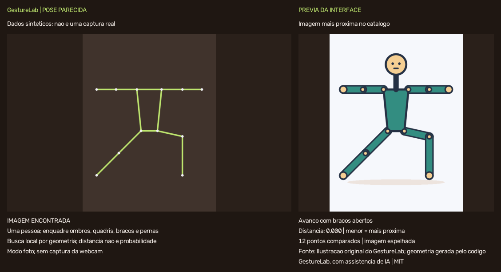

# GestureLab · Mãos, gestos, escrita no ar e poses

> Laboratório de visão computacional em Python: quatro modos independentes para explorar mãos, gestos, desenho no ar e busca de imagens por semelhança de pose corporal.



[](https://github.com/luigiscofano/gesturelab/actions/workflows/ci.yml)

[O que faz](#o-que-este-projeto-faz) · [Módulos](#funcionalidades-e-módulos) · [Executar](#como-executar) · [Aprendizagem](#o-que-desenvolvi-e-aprendi) · [Estado atual](#estado-atual) · [Documentação](#documentação-e-navegação)

## O que este projeto faz

Transforma a webcam em uma interface visual: localiza pontos das mãos ou do corpo e usa essas coordenadas para desenhar conexões, mostrar gestos, produzir traços e comparar poses. É uma aplicação **local de desktop**, iniciada pelo terminal. Usa modelos pré-treinados do MediaPipe e quatro modos selecionáveis; um modo é executado por vez.

## Qual problema resolve

O projeto aproxima a saída de um detector visual de uma aplicação que o usuário consegue experimentar. Coordenadas isoladas passam a controlar uma caneta ou uma comparação geométrica, com estados, limites de aceitação, tratamento de arquivos e testes. Também permite estudar onde termina a detecção fornecida por um modelo e onde começa a lógica da aplicação.

## Funcionalidades e módulos

| Quero fazer | Modo | Entrada | Resultado |
| --- | --- | --- | --- |
| Inspecionar a detecção das mãos | `hands` | Webcam ou foto | 21 pontos por mão, conexões e indicação de lado |
| Identificar um gesto conhecido | `gestures` | Webcam ou foto | Classe predefinida e pontuação do modelo |
| Desenhar com o indicador | `airwrite` | Sequência da webcam | Traços persistentes; exportação PNG e JSON |
| Encontrar uma pose semelhante | `posematch` | Webcam ou foto + catálogo local | Referência aceita mais próxima e medida geométrica |

### 1. Rastreamento de mãos — hands

Mostra onde o modelo localiza punho e articulações. Os pontos são desenhados sobre a imagem; `--show-indices` permite relacionar cada índice à anatomia usada pelas regras. O padrão procura até duas mãos. É a melhor primeira demonstração, porque ajuda a avaliar iluminação, enquadramento e detecção antes de usar os outros modos.

```sh
python app.py --mode hands --show-indices
```

### 2. Reconhecimento de gestos — gestures

Acrescenta os rótulos do modelo para sete classes, como mão aberta, punho fechado, vitória e polegar para cima. `--threshold` define quando uma classificação deve ser mostrada; o padrão 0.65 é um ponto de partida, não uma acurácia medida. Não há treinamento de novos gestos nesta versão.

```sh
python app.py --mode gestures --threshold 0.65
```

### 3. Escrita no ar — airwrite

Mantém a ponta do indicador como cursor e produz traços separados. Deixe apenas uma mão visível, estenda o indicador e recolha médio, anelar e mínimo. Mantenha essa pose brevemente e mova o dedo. Abra a mão ou dobre o indicador para levantar a caneta e reposicionar sem unir partes do desenho.

```sh
python app.py --mode airwrite --canvas
```

| Controle | Efeito |
| --- | --- |
| Espaço | Pausar/retomar a ferramenta |
| C / Z | Limpar o desenho / desfazer o último traço |
| B | Alternar webcam e fundo branco |
| S | Salvar tinta em PNG e trajetórias em JSON em `outputs/` |
| Q ou Esc | Sair |

A suavização reduz oscilações do cursor, mas introduz atraso. O programa guarda desenho e trajetórias; **reconhecimento de letras, palavras e números ainda é uma evolução**, não uma funcionalidade entregue.

### 4. Poses parecidas — posematch

Compara articulações do corpo com um catálogo local de imagens e poses. A normalização geométrica reduz diferenças de posição e escala; o ranking usa distâncias, e um limiar pode rejeitar resultados pouco semelhantes. O catálogo inicial contém **12 ilustrações originais**, com geometria conhecida. Para fotografias próprias, use o [guia do catálogo](pose_gallery/README.md).

```sh
python app.py --mode posematch
```

O modo não pesquisa imagens na internet e não depende dos modos de mãos ou escrita. Distância menor significa maior proximidade sob o descritor usado; não é uma porcentagem de acerto nem validação semântica da imagem.



A prévia usa entrada sintética e uma referência do catálogo; não é uma captura de webcam ou uma medição de desempenho.

## Como executar

**Requisitos:** Python 3.12 de 64 bits, Git, webcam e ambiente gráfico. É necessária conexão para instalar dependências e baixar os modelos; a inferência é local depois da preparação. Feche outros aplicativos que estejam usando a câmera.

```sh
git clone https://github.com/luigiscofano/gesturelab.git
cd gesturelab
```

Crie um ambiente com **Python 3.12**:

```sh
python -m venv .venv
```

Ative-o no terminal que você usa:

| Sistema | Comando |
| --- | --- |
| Windows / PowerShell | `.\.venv\Scripts\Activate.ps1` |
| Linux / macOS | `source .venv/bin/activate` |

Se seu sistema oferece apenas `python3`, use esse nome ao criar o ambiente. A partir daqui, execute os comandos na raiz do repositório, com o ambiente ativado.

```sh
python -m pip install -r requirements.txt
```


Baixe os modelos, confira o ambiente e inicie a primeira demonstração:

```sh
python scripts/download_models.py
python scripts/check_environment.py --imports --models all
python app.py --mode hands
```

Deve abrir uma janela com a imagem da câmera e os pontos detectados. Pressione **Q** ou **Esc** para sair. Para trocar de função, feche a janela e execute outro `--mode`. Se a câmera não for a de índice zero, tente `--camera 1`.

### Processar sua própria foto

Substitua `foto.jpg` por um arquivo real do seu computador:

```sh
python app.py --mode hands --image foto.jpg --output resultado.jpg
```

Essa forma não abre a webcam. Está disponível também em `gestures` e `posematch`; `airwrite` exige sequência temporal. Na webcam, `--headless` exige um limite `--max-frames`. As opções completas estão em [USO.md](docs/USO.md).

### Verificar o código

```sh
python -m pip install -r requirements-dev.txt
python -m ruff format --check .
python -m ruff check .
python -m pytest -q
```

Os testes de lógica não precisam de webcam nem dos pesos dos modelos. A validação com imagens, a sessão de câmera e a interface são verificações diferentes. Para câmera, permissões, modelos ausentes ou instalação, consulte [a solução de problemas](docs/SOLUCAO_DE_PROBLEMAS.md).

## O que desenvolvi e aprendi

O trabalho da aplicação inclui organização por responsabilidades, CLI, captura e visualização, estado da caneta, suavização, exportação, descritor geométrico, ranking, catálogo reproduzível e testes. Os detectores visuais são fornecidos pelo **MediaPipe**; a integração não é apresentada como treinamento de modelos próprios.

As competências exercitadas são processamento de imagens, coordenadas, estado temporal, separação entre domínio e dependências, validação de entradas e limites de métricas. Uma atividade de estudo é alterar o limiar do PoseMatch e registrar tanto rejeições quanto falsos candidatos, sem chamar a distância de acurácia.

## Estado atual

| Disponível | Em desenvolvimento / evolução proposta |
| --- | --- |
| Quatro modos, webcam e processamento de foto onde compatível | Gestos próprios e avaliação ampliada |
| Caneta com traços, desfazer e exportação | Reconhecimento do conteúdo escrito |
| Comparação com catálogo local e rejeição por limiar | Catálogo maior e benchmark independente |
| Testes, lint e CI em Windows/Ubuntu | Avaliação sistemática de uso em equipamentos e ambientes diversos |

## Validação e limites

Há testes de geometria, estados, entradas, arquivos e regressões, além de inferência com imagens registrada em [VALIDACAO.md](docs/VALIDACAO.md). Nenhum score do modelo ou descritor é convertido em promessa de acerto. O espelhamento afeta a visualização; o modelo recebe a imagem original. Iluminação, oclusão, enquadramento e câmera afetam a experiência.

## Documentação e navegação

| Preciso de… | Onde encontrar |
| --- | --- |
| Instalação e solução de problemas | [Instalação](docs/INSTALACAO.md) e [diagnóstico](docs/SOLUCAO_DE_PROBLEMAS.md) |
| Regras, teclas e opções | [Guia de uso](docs/USO.md) |
| Entender e alterar o código | [Mapa](docs/MAPA_DO_PROJETO.md) e [arquitetura](docs/ARQUITETURA.md) |
| Estudar cada mecanismo | [Guia completo](docs/GUIA_COMPLETO.md) e [escrita](docs/ESCRITA_NO_AR.md) |
| Estudar busca corporal | [PoseMatch](docs/posematch/README.md) e [catálogo](pose_gallery/README.md) |
| Modelos e exemplos de inferência | [models/](models/README.md), [imagens de exemplo](docs/assets/README.md) |
| Testes e próximos passos | [tests/](tests/README.md), [validação](docs/VALIDACAO.md), [roadmap](docs/ROADMAP.md) |
| Índice geral | [docs/](docs/README.md) |


## Autoria, referências e licença

**Luigi Scofano de Araujo · Engenharia de Computação, Poli-USP · USP 13680334.** Fontes recuperados, componentes de terceiros e trabalhos em grupo mantêm os créditos indicados nos arquivos e na documentação.

[Dependências e créditos](THIRD_PARTY_NOTICES.md) · [Licença](LICENSE) · [Como contribuir](CONTRIBUTING.md) · [Mudanças](CHANGELOG.md)

## Tópicos do repositório

`python` · `computer-vision` · `opencv` · `mediapipe` · `hand-tracking` · `gesture-recognition` · `air-writing` · `pose-estimation` · `pose-matching` · `educational`
