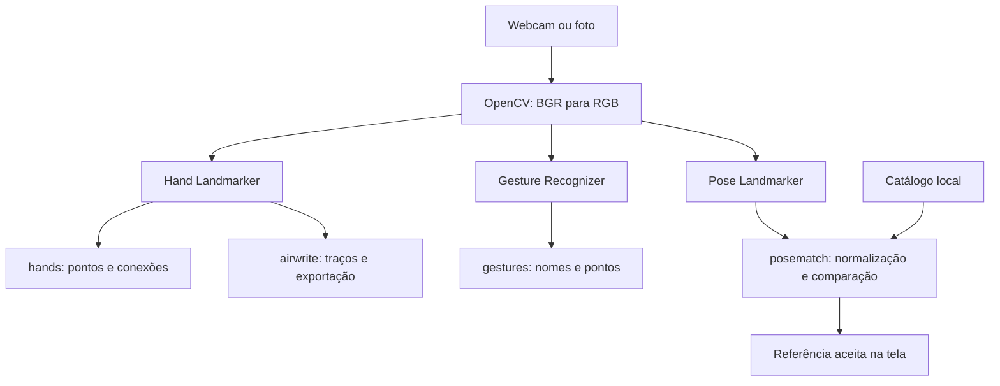

# Arquitetura do GestureLab

[Início](../README.md) · [Documentação](README.md) · [Mapa do projeto](MAPA_DO_PROJETO.md)

**Nesta página**

- [Estado implementado](#estado-implementado)
- [Modo de escrita no ar](#modo-de-escrita-no-ar)
- [Busca de imagens por pose corporal](#busca-de-imagens-por-pose-corporal)
- [Dependências e manutenção](#dependências-e-manutenção)
- [Evolução planejada](#evolução-planejada)

## Estado implementado

[app.py](../app.py) valida os argumentos e inicia o modo escolhido. [hand_app.py](../hand_app.py) executa
os modos de mãos e escrita; [pose_match_app.py](../pose_match_app.py) executa a busca corporal.
[vision_runtime.py](../vision_runtime.py) reúne as dependências de visão e as operações compartilhadas
de imagem e câmera. Os módulos de geometria e estado continuam independentes
dessas bibliotecas.

O programa usa exatamente uma tarefa por execução: Hand Landmarker em `hands`
e `airwrite`, Gesture Recognizer em `gestures` ou Pose Landmarker em `posematch`.

O diagrama reúne as alternativas; somente o caminho do modo escolhido é executado.
`airwrite` usa uma sequência da webcam. Os demais modos também aceitam uma foto.

| Etapa | Entrada | Saída |
| --- | --- | --- |
| Captura ou leitura | Webcam ou caminho de uma foto | Frame BGR |
| Conversão | Frame BGR | Imagem RGB contígua |
| Inferência | Imagem e, em VIDEO, timestamp crescente | Pontos das mãos ou corpo; lateralidade nas mãos e categorias em gestures |
| Decisão de rótulo | Nome e score | Nome conhecido ou DESCONHECIDO |
| Visualização | Frame original e resultados | Imagem com pontos, conexões e textos |

O modo webcam usa `VIDEO`, de modo síncrono. Isso mantém resultado e frame juntos.
O modo foto usa `IMAGE`. `LIVE_STREAM` é uma evolução possível, mas pede tratamento
de callbacks, concorrência e resultados atrasados.

O espelhamento ocorre na exibição. O input do modelo é preservado. Ao espelhar,
as coordenadas horizontais desenhadas são transformadas; os textos permanecem
legíveis. Uma webcam virtual que já entregue imagens espelhadas exige verificação
local da convenção de mão esquerda e direita.

Os índices das mãos na saída não são IDs de rastreamento. Antes de acrescentar
histórico por mão, implemente associação temporal ou limite a experiência a uma mão.

## Modo de escrita no ar

[airwriting.py](../airwriting.py) recebe posições e condições de escrita, mantém traços separados,
aplica suavização e encerra a continuidade ao perder a pose, a mão ou a condição
de rastreamento. A interface em [hand_app.py](../hand_app.py) exibe os traços sobre vídeo ou branco,
processa atalhos e exporta PNG + JSON quando solicitado.

O PNG contém só a tinta. O JSON preserva os traços, pontos, tempos e convenção de
pixels da visualização. Fim de traço não equivale a fim de caractere. Reconhecimento
de letras e agrupamento em caracteres ainda são desenvolvimentos futuros.

A confirmação de entrada na escrita pertence ao modo `airwrite`. Ela não torna
os rótulos do modo `gestures` temporalmente estáveis por si só.

## Busca de imagens por pose corporal

[app.py](../app.py) valida a CLI e encaminha `posematch` para [pose_match_app.py](../pose_match_app.py). Esse módulo
cuida de captura, inferência corporal, confirmação temporal e composição da tela.
O ranking está em [pose_matching.py](../pose_matching.py), com dataclasses e funções puras: não importa
OpenCV/MediaPipe e pode ser testado sem câmera ou pesos.

O catálogo contém imagens e landmarks no referencial de cada imagem. A pose
capturada é normalizada antes de ser comparada às referências; o resultado é a
menor distância aceita no catálogo, incluindo a hipótese espelhada. A distância
é geométrica, não é uma probabilidade calibrada. O sistema limpa a referência
quando não há uma pose utilizável, em vez de atribuir a imagem anterior à cena atual.

[file_io.py](../file_io.py) reúne a criação exclusiva de arquivos utilizada pela foto anotada,
pelo desenho e pela comparação de poses. Essa pequena extração evita dependência
circular entre os modos e mantém uma única implementação da proteção de saídas.

Leia [posematch/README.md](posematch/README.md) para o contrato da comparação e
[o README do catálogo](../pose_gallery/README.md) para os dados de referência.

## Dependências e manutenção

`VisionDependencies` dá nomes aos módulos carregados em tempo de execução. O
acesso a OpenCV, NumPy e MediaPipe não depende da posição de um item em uma tupla.
Ajuda da CLI e testes de lógica continuam funcionando sem importar essas bibliotecas.

O código compartilhado fica nas operações com o mesmo contrato, como preparar
uma imagem RGB e liberar a câmera. As decisões de cada modo permanecem no seu
runtime: controles da caneta, confirmação da referência e desenho dos painéis.

Os testes cobrem os contratos públicos e os casos de falha relevantes. Ruff
padroniza a formatação e verifica imports, sintaxe, simplificações e erros comuns.
As convenções estão no [guia de contribuição](../CONTRIBUTING.md#estilo-de-código).

## Evolução planejada

1. `features.py`: normalização e atributos geométricos.
2. `collect.py`: coleta explícita de landmarks e metadados de sessões.
3. `train.py`: treino e exportação do classificador.
4. `evaluate.py`: avaliação por grupos e análise de erros.
5. `interaction.py`: confirmação temporal e geração de eventos.

Esses módulos ainda não existem. Crie-os quando a entrega correspondente começar.
Não é necessário preparar uma arquitetura complexa antes de ter uma primeira
interação funcionando.

## Referências

- https://developers.google.com/edge/mediapipe/solutions/vision/hand_landmarker/python
- https://developers.google.com/edge/mediapipe/solutions/vision/gesture_recognizer/python
- https://ai.google.dev/edge/mediapipe/solutions/vision/pose_landmarker/python

---

**Próxima leitura:** [mapa dos arquivos](MAPA_DO_PROJETO.md), [testes](../tests/README.md) e [como contribuir](../CONTRIBUTING.md).
