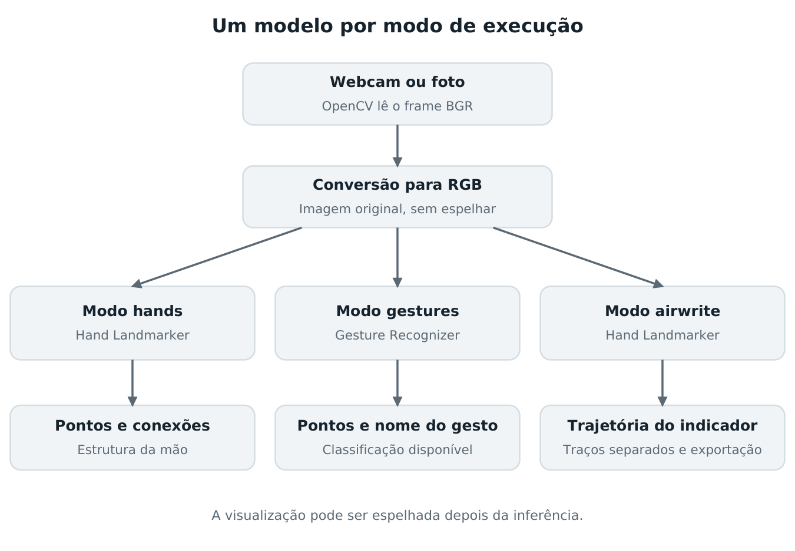
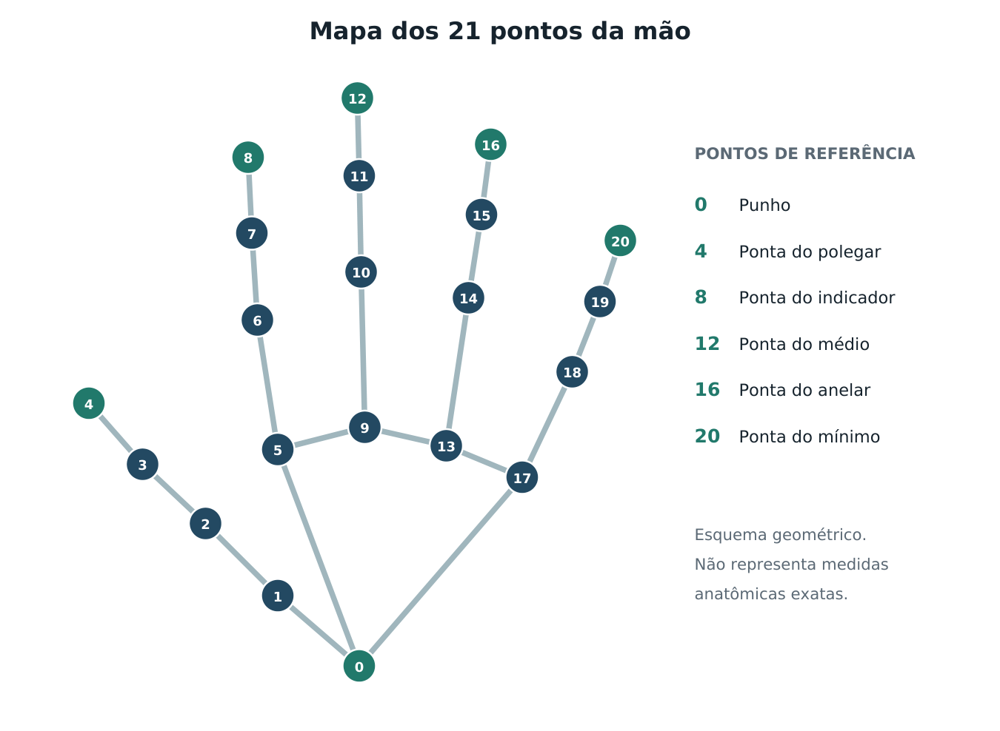

# GestureLab

Guia para construir um projeto de visão computacional com webcam e apresentá-lo no portfólio

Preparado para Luigi Scofano de Araujo. Referências técnicas consultadas em 30 de outubro de 2026.

## 1. O projeto que você vai construir

Minha recomendação é criar o **GestureLab**, um laboratório de rastreamento e reconhecimento de mãos em tempo real. O nome é provisório. A primeira entrega reproduz o comportamento principal do post: abrir a webcam, identificar mãos e desenhar pontos e conexões sobre a imagem. Depois, a aplicação passa a mostrar o nome de gestos. Uma terceira versão aprende gestos definidos por você e executa uma ação útil.

Como a referência mostra mãos, este guia começa por poses das mãos. A seção 13 explica a evolução para poses do corpo inteiro. As duas tarefas precisam de componentes e avaliações diferentes.

Você vai construir a aplicação desde a preparação do ambiente. Na primeira fase, o detector visual será um modelo pré-treinado do MediaPipe. Sua contribuição será integrar câmera, processamento, visualização, tratamento de erros, testes e documentação. Mais adiante, você treinará um classificador próprio sobre os pontos extraídos. Treinar o detector de mãos a partir de imagens brutas é um projeto muito maior e desnecessário para este primeiro objetivo.

| Versão sugerida | Resultado visível | O que você pratica |
| --- | --- | --- |
| v0.1 | Pontos e conexões em até duas mãos | Python, imagens, câmera e integração de modelos |
| v0.2 | Nome dos gestos disponíveis no modelo | Classificação, limiares e desenho de interface |
| v0.3 | Escrita no ar com traços separados | Trajetórias, estados, suavização e exportação |
| v0.4 | Rótulos estáveis e regras geométricas | Tempo, estados, geometria e tratamento de ruído |
| v0.5 | Gestos próprios e avaliação documentada | Dataset, aprendizado supervisionado e experimentos |
| v1.0 | Uma interação útil e demonstrável | Produto, engenharia e apresentação profissional |

Os números de versão são uma proposta de organização. O kit inicial trouxe os modos de rastreamento, gestos prontos e escrita no ar para execução local. A escrita possui confirmação de entrada, suavização e exportação. Uma atualização acrescentou `posematch`, que encontra imagens de referência por semelhança de pose corporal; seu uso está em [posematch/README.md](posematch/README.md). Coleta rotulada, treinamento próprio, estabilização dos nomes no modo gestures e reconhecimento da escrita continuam sendo próximos desenvolvimentos.

## 2. Como o sistema funciona

Uma webcam produz uma sequência de imagens, chamadas frames. O OpenCV lê esses frames, o MediaPipe estima os pontos das mãos, e o OpenCV desenha o resultado. No modo de reconhecimento, um classificador também atribui um rótulo à configuração da mão. [1][2][3]



**Detecção** encontra a mão na imagem. **Estimação de landmarks** localiza pontos associados ao punho e às articulações. **Rastreamento** aproveita a continuidade entre frames. **Classificação** associa a configuração dos pontos a um nome, como palma aberta. Essas operações se relacionam, mas desenhar um esqueleto não significa que o sistema já sabe o nome de qualquer pose.

O Hand Landmarker fornece 21 pontos por mão. Cada ponto tem coordenadas x, y e z, portanto uma mão pode ser representada por 63 valores. Nos landmarks da imagem, x e y são normalizados pelas dimensões da imagem; z indica profundidade relativa ao punho, aproximadamente na escala de x. O modelo também fornece world landmarks estimados em metros, com outra origem. Nenhuma dessas saídas transforma a webcam em um instrumento de medição de distância calibrado. [1]

| Índices | Região | Ponto mais útil para começar |
| --- | --- | --- |
| 0 | Punho | Referência para centralizar a mão |
| 1 a 4 | Polegar | 4 é a ponta |
| 5 a 8 | Indicador | 8 é a ponta |
| 9 a 12 | Médio | 12 é a ponta |
| 13 a 16 | Anelar | 16 é a ponta |
| 17 a 20 | Mínimo | 20 é a ponta |



Para desenhar um ponto, transforme a coordenada normalizada em pixels. A ideia é `px = x * largura` e `py = y * altura`; ao converter para inteiro, limite o resultado às bordas válidas da imagem. Se o quadro tem 1280 por 720 pixels e um ponto está em x = 0,25 e y = 0,50, ele fica aproximadamente em (320, 360).

O frame recebido pelo OpenCV usa normalmente a ordem de cores BGR. A imagem entregue ao MediaPipe deve usar RGB. Você converte uma cópia para inferência e mantém a imagem BGR para exibição. [1][3]

## 3. Linguagens e ferramentas

Comece com **Python**. Ele permite concentrar o esforço no funcionamento do sistema. JavaScript ou TypeScript entram depois, quando houver interesse em uma demonstração no navegador. C++ é uma possibilidade futura para necessidades específicas de desempenho, mas não é requisito deste projeto.

| Ferramenta | Papel no projeto | Quando usar |
| --- | --- | --- |
| Python 3.12 de 64 bits | Linguagem da aplicação | Desde o começo |
| MediaPipe Tasks | Modelos de mãos e gestos | Desde o começo |
| OpenCV, importado como cv2 | Webcam, imagens, linhas, pontos e janela | Desde o começo |
| NumPy | Representação e operações sobre coordenadas | Desde o começo |
| VS Code e extensão Python | Editor, terminal e depuração | Desde o começo |
| Git | Histórico de mudanças no computador | Desde o primeiro avanço |
| GitHub | Repositório remoto e apresentação | Após o primeiro protótipo |
| pytest e Ruff | Testes de lógica e verificação de código | Quando organizar os módulos |
| scikit-learn | Classificador próprio | Depois dos gestos prontos |
| pandas e Matplotlib | Dataset, tabelas e gráficos | Na fase experimental |
| Jupyter | Exploração dos dados e experimentos | Opcional, na fase de ML |
| OBS Studio | Gravar uma demonstração | Ao preparar o portfólio |
| HTML, CSS e JavaScript ou TypeScript | Demonstração na web | Evolução posterior |

Python 3.12 é a base escolhida para o kit, não uma afirmação de que seja a versão mais recente. A documentação atual do MediaPipe informa suporte a Python 3.9 ou posterior, sujeito à disponibilidade do pacote para o sistema e a arquitetura. Windows, macOS e Linux estão listados. [4]

Use um computador com webcam; a câmera integrada é suficiente para começar. A proposta inicial usa CPU e modelos prontos. Não há necessidade de contratar uma API de IA ou preparar treinamento em GPU para a primeira etapa. A fluidez depende da máquina, da resolução e do número de mãos: comece em uma resolução moderada e meça.

**Uma atualização importante em relação ao post:** ele usa `mediapipe.solutions.hands`, pertencente à API antiga. O projeto novo usa `mediapipe.tasks.python.vision.HandLandmarker` e `GestureRecognizer`. Os mantenedores orientam a migração para Tasks. Não misture exemplos das duas APIs. [5]

Instale apenas uma distribuição de OpenCV no ambiente. O kit usa `opencv-contrib-python`, que disponibiliza `cv2`; instalar também `opencv-python` ou uma variante headless pode criar conflitos. A variante headless não é adequada à janela local com `cv2.imshow`. [6]

## 4. Preparar o ambiente no Windows

### 4.1 Instalar os programas

1. Instale Python de 64 bits a partir de python.org. Para seguir exatamente a base do kit, use Python 3.12. Se usar outra versão suportada, registre-a e valide a instalação das dependências.
2. Instale o VS Code a partir de code.visualstudio.com e a extensão Python da Microsoft.
3. Instale Git a partir de git-scm.com e crie ou use sua conta no GitHub.
4. Extraia o ZIP em uma pasta de projetos, por exemplo `C:\Projetos\gesturelab`. Abra a pasta que contém `app.py` e `requirements.txt`.
5. No VS Code, use File > Open Folder e abra essa pasta. Abra o terminal integrado em modo PowerShell.

Confira as instalações:

```powershell
py --list
py -3.12 --version
git --version
```

Se o comando `py` não existir, verifique se `python --version` aponta para o Python correto e use `python` para criar o ambiente. Não crie arquivos chamados `mediapipe.py`, `cv2.py` ou `numpy.py`, pois eles podem esconder as bibliotecas reais na importação.

### 4.2 Criar um ambiente isolado

Dentro da pasta do projeto:

```powershell
py -3.12 -m venv .venv
.\.venv\Scripts\python.exe -m pip install --upgrade pip
.\.venv\Scripts\python.exe -m pip install -r requirements.txt
.\.venv\Scripts\python.exe -m pip check
```

O ambiente virtual guarda as dependências deste projeto separadamente. Os comandos chamam diretamente seu Python, então não dependem de ativar scripts do PowerShell. No VS Code, use `Ctrl+Shift+P`, procure `Python: Select Interpreter` e selecione `.venv\Scripts\python.exe`. [7][8]

### 4.3 Baixar os modelos

```powershell
.\.venv\Scripts\python.exe scripts\download_models.py
```

O script baixa os modelos oficiais para a pasta `models`, usando URLs versionadas e verificação SHA256. Isso deixa o repositório pequeno e registra quais arquivos foram usados. Os pesos não são treinados pelo kit nem precisam ser incluídos em cada commit.

### 4.4 Rodar o primeiro modo

```powershell
.\.venv\Scripts\python.exe app.py --mode hands
```

Autorize o acesso à webcam quando o sistema solicitar. A janela deve mostrar a imagem e, quando houver mãos visíveis, os pontos e as conexões. Consulte `--help` para todos os argumentos e os controles indicados no README.

```powershell
.\.venv\Scripts\python.exe app.py --help
.\.venv\Scripts\python.exe app.py --mode hands --camera 1
.\.venv\Scripts\python.exe app.py --mode hands --no-mirror
```

O índice 0 é a primeira tentativa de câmera; 1 pode apontar para outra câmera disponível. Não é uma garantia de correspondência com a câmera externa. Se houver tela preta, feche outros programas que estejam usando o dispositivo e confira a permissão de câmera para aplicativos de desktop.

### 4.5 Alternativa para macOS e Linux

Os comandos principais são os mesmos, mudando o caminho do executável:

```bash
python3.12 -m venv .venv
.venv/bin/python -m pip install --upgrade pip
.venv/bin/python -m pip install -r requirements.txt
.venv/bin/python scripts/download_models.py
.venv/bin/python app.py --mode hands
```

A disponibilidade do wheel e da interface gráfica varia por sistema e arquitetura. No macOS, confirme a permissão de câmera do terminal ou editor. Para a primeira experiência, prefira o Python instalado no próprio computador: ambientes remotos e notebooks em nuvem não acessam sua webcam local por meio de `VideoCapture(0)` da mesma maneira.

## 5. Construir entendendo cada etapa

O kit é uma base para estudar e modificar. Para conseguir explicar o projeto em uma entrevista, refaça mentalmente e, se possível, em pequenos arquivos de exercício, as etapas abaixo. Não precisa escrever tudo de uma vez.

### Etapa A Abrir a câmera

Crie um loop que abre `cv2.VideoCapture(0)`, verifica `isOpened()`, lê um frame e confere o retorno de `read()`. Exiba com `imshow`, processe a tecla de saída e libere câmera e janelas ao terminar. A documentação oficial do OpenCV mostra esse ciclo. [3]

**Critério de conclusão:** a imagem abre, a tecla de saída funciona e uma tentativa de abrir câmera inexistente produz uma mensagem compreensível.

### Etapa B Entregar a imagem ao modelo

Converta BGR para RGB e construa `mp.Image` com `mp.ImageFormat.SRGB`. Crie o detector uma vez, fora do loop. Configure até duas mãos para reproduzir a referência. Recriar o modelo em todo frame desperdiça trabalho e prejudica a experiência.

O núcleo do processamento tem esta forma conceitual:

```python
rgb = cv2.cvtColor(frame, cv2.COLOR_BGR2RGB)
image = mp.Image(image_format=mp.ImageFormat.SRGB, data=rgb)
result = landmarker.detect_for_video(image, timestamp_ms)
```

Esse trecho não é um programa completo: o modelo, o loop, o timestamp e o tratamento de erros estão no kit. No modo VIDEO, os timestamps precisam crescer em milissegundos. Para webcam, use relógio monotônico e assegure um incremento mínimo entre chamadas. [1]

### Etapa C Desenhar os pontos

Percorra os landmarks de cada mão. Converta coordenadas para pixels e desenhe círculos e linhas segundo a conectividade da mão. Primeiro verifique se as pontas dos dedos acompanham o movimento; depois ajuste tamanho e cor dos elementos. Os 21 pontos representam uma estrutura estimada, então haverá imprecisões e perdas de detecção em certas condições.

### Etapa D Separar inferência e visualização

O kit processa a imagem original e espelha apenas a visualização quando solicitado. Os textos são desenhados de forma legível. A documentação atual informa que Left e Right correspondem às mãos da pessoa e que espelhar a imagem de entrada inverte essas saídas. Confirme isso no seu equipamento levantando a mão direita e observando o rótulo. [1]

### Etapa E Medir e tratar falhas

Acrescente um contador de frames, tempo de inferência e FPS do loop. Teste zero, uma e duas mãos, entrada e saída do quadro, movimentos mais rápidos e fundos diferentes. FPS do loop descreve uma medida de execução; não é automaticamente a taxa física da câmera nem a latência completa da experiência.

**Primeira entrega concluída:** a aplicação abre a câmera, desenha os landmarks de até duas mãos, lida com ausência de detecção, informa falhas e fecha corretamente. Grave um vídeo curto e registre o ambiente. Esse é o momento de criar a primeira versão no GitHub.

## 6. Identificar e nomear gestos

Na segunda etapa, use `GestureRecognizer`. Ele já entrega landmarks, lateralidade e categorias de gestos, portanto não há necessidade de rodar Hand Landmarker e Gesture Recognizer separadamente sobre cada frame. [2]

```powershell
.\.venv\Scripts\python.exe app.py --mode gestures
```

O modelo pronto reconhece sete gestos. Você pode escolher os nomes apresentados ao usuário sem alterar o modelo:

| Saída do modelo | Nome sugerido em português |
| --- | --- |
| Closed_Fist | Punho fechado |
| Open_Palm | Palma aberta |
| Pointing_Up | Indicador para cima |
| Thumb_Down | Polegar para baixo |
| Thumb_Up | Polegar para cima ou joinha |
| Victory | Vitória ou sinal de V |
| ILoveYou | Sinal I love you |

Essa lista é a capacidade do modelo pronto, não um vocabulário ilimitado. Há ainda o caso `None` ou uma saída equivalente de gesto não reconhecido. Ausência de mão e mão presente com gesto desconhecido devem aparecer como estados diferentes. [2][9]

O kit aplica um limiar inicial de score para evitar exibir rótulos fracos. Um valor como 0,65 é um ponto de partida para experimentar, não uma garantia de acerto. O score de uma previsão também não é a acurácia do projeto: acurácia é calculada comparando várias previsões com rótulos corretos conhecidos.

### Tornar os nomes estáveis

O próximo desenvolvimento deve confirmar um gesto por um intervalo curto, por exemplo 200 a 300 milissegundos, antes de mudar o rótulo. Esses valores são hipóteses iniciais e precisam ser ajustados com testes. Um filtro muito forte reduz oscilações, mas aumenta o atraso percebido.

Comece a estabilização com uma mão. Com duas, a ordem das detecções pode mudar: o índice 0 de uma lista não deve ser tratado como a mesma mão para sempre. Associe resultados usando posição, lateralidade e continuidade; limpe o estado quando a mão desaparecer por tempo suficiente.

Se um gesto executar uma ação, crie estados explícitos: aguardando, candidato, confirmado e aguardando liberação. Um joinha mantido por dois segundos deve gerar um evento quando confirmado, não centenas de eventos, um por frame. Acrescente uma forma de pausar e um intervalo entre ações quando necessário.

## 7. Usar geometria para criar regras próprias

Antes de treinar um classificador, experimente regras geométricas. Elas ajudam a entender por que dois gestos são confundidos e fornecem uma referência simples para comparar com ML.

Um exemplo útil é reconhecer uma **pinça** entre polegar e indicador. Use as pontas 4 e 8. Defina os pontos em pixels como `P_i = (x_i * W, y_i * H)` e calcule a razão:

```text
distancia_pinça = norma(P4 - P8)
largura_palma = norma(P5 - P17)
razao = distancia_pinça / max(largura_palma, epsilon)
```

Dividir pela largura da palma reduz o efeito de aproximar a mão da câmera. Não compare uma distância fixa, como 20 pixels, em qualquer resolução e distância. Também não calcule distâncias diretamente em x e y normalizados sem considerar que os eixos foram divididos por W e H diferentes: uma imagem retangular distorce essa geometria.

Outra ideia é medir ângulos entre segmentos dos dedos para estimar se estão estendidos. A regra “ponta acima da articulação” só é adequada a certas orientações da mão. Ao girar a mão, ela pode falhar. O polegar precisa de tratamento próprio.

Use limiares distintos para entrar e sair de um estado, uma técnica chamada histerese. Por exemplo, a pinça pode ser ativada abaixo de uma razão e permanecer ativa até superar uma razão um pouco maior. Escolha esses valores com exemplos reais, incluindo transições e casos difíceis. A geometria 2D continua sensível à perspectiva e à oclusão; a normalização não elimina esses problemas.

## 8. Criar um dataset de gestos

Esta etapa dá ao projeto uma contribuição experimental própria. Defina primeiro o problema: reconhecer um conjunto pequeno de gestos estáticos, feitos por uma pessoa por vez, diante de uma câmera. Comece com quatro ou cinco classes visualmente distintas e exemplos de outros gestos.

Escolha classes úteis para a aplicação, como pinça, apontar para a direita e um gesto de confirmar. Documente exatamente o que conta como cada classe, com desenhos ou imagens autorizadas. Um rótulo ambíguo produz um dataset ambíguo.

### Coleta inicial

Faça um piloto com você em três sessões diferentes. Para cada classe, apresente a pose algumas vezes, relaxando a mão entre apresentações. Mude um pouco distância, posição e inclinação. Ajuste o coletor antes de convidar outras pessoas.

Como plano inicial ampliado, considere seis participantes, três sessões por participante, seis categorias incluindo outros e dez apresentações independentes por categoria em cada sessão. Isso daria **1080 apresentações**. É um exemplo de planejamento, não um mínimo científico nem garantia de desempenho. Pode começar menor e ampliar conforme os erros observados.

Uma apresentação é um episódio em que a pessoa faz a pose novamente. Se você extrair dez frames desse episódio, terá dez observações correlacionadas, não dez experimentos independentes. Centenas de frames quase iguais de um único vídeo não substituem diversidade.

| Campo | Por que guardar |
| --- | --- |
| participant_id | Separar pessoas entre conjuntos |
| session_id | Identificar dia e condições de coleta |
| presentation_id | Manter frames do mesmo episódio juntos |
| label | Classe anotada para aquela pose |
| timestamp_ms | Preservar sequência temporal |
| hand_detected | Contar também apresentações sem detecção válida |
| handedness | Analisar esquerda e direita |
| width e height | Interpretar coordenadas de imagem |
| x0, y0, z0 até x20, y20, z20 | Representação dos landmarks |
| observações | Iluminação, oclusão e erros de coleta |

CSV é suficiente para começar; Parquet pode entrar quando o volume justificar. A coleta deve salvar dados apenas quando você ativar esse modo. Prefira códigos de participante a nomes. Se trabalhar com outras pessoas, combine o uso dos registros e das imagens de demonstração. No repositório público, publique o protocolo e exemplos permitidos; não inclua automaticamente todas as gravações.

Inclua mãos parcialmente ocultas, posições intermediárias e gestos fora do vocabulário nos testes. Uma coleção só de poses perfeitas pode mascarar o problema que aparece durante o uso contínuo.

Registre também as apresentações em que a mão estava visível, mas não foi detectada; os landmarks podem ficar ausentes nesses registros. Avalie separadamente o classificador em exemplos válidos e o sistema completo em todas as apresentações. Descartar silenciosamente falhas do detector faz o resultado parecer melhor do que a experiência real.

## 9. Treinar um classificador próprio

O primeiro modelo pode ser uma regressão logística, um SVM ou uma Random Forest. Escolha uma referência simples e compare uma alternativa. Não é preciso começar com uma rede profunda ou um modelo de linguagem.

### Preparar os atributos

Você pode começar pelos 21 pontos, centralizados no punho e normalizados por uma medida da palma. Para landmarks da imagem, uma representação com unidades coerentes é `Q_i = (x_i, y_i * H/W, z_i)`, pois z usa aproximadamente a escala de x. Outra opção é trabalhar com world landmarks, registrando que são estimativas do modelo. Depois defina `F_i = (Q_i - Q_0) / max(s, epsilon)`, em que s é uma medida estável da palma.

Isso reduz a influência da posição e do tamanho aparente da mão. Não resolve toda rotação 3D nem oclusão. Experimente distâncias e ângulos como atributos adicionais. Se a orientação for relevante para o gesto, preservá-la é necessário: uma normalização que apaga direita e esquerda pode destruir a distinção entre duas classes.

Se a escala da palma ficar pequena demais ou a detecção estiver degradada, marque o exemplo como inválido ou rejeite-o. O epsilon evita divisão por zero, mas não recupera informação ausente nem torna confiável uma configuração degenerada.

Padronização aprendida, como `StandardScaler`, deve ser ajustada apenas no treino. Organize transformações e classificador em uma `Pipeline` para reduzir o risco de vazamento de dados. [10]

### Separar os dados corretamente

Se o objetivo é funcionar com pessoas novas, separe participantes. Em um exemplo com seis pessoas, use quatro para treino, uma para validação e uma para teste, mantendo todas as sessões de cada pessoa no mesmo conjunto. Essa avaliação ainda é pequena; deixe isso claro e, quando possível, complemente com validação cruzada por grupos.

A validação cruzada ocorre apenas nos dados de desenvolvimento. A pessoa reservada ao teste final permanece fora da escolha de atributos, modelos, hiperparâmetros e limiares. Se os erros do teste orientarem uma nova versão, reserve novos dados para sua avaliação final ou declare que o teste anterior já informou decisões.

Se só houver dados seus, separe sessões ou dias e descreva o resultado como generalização entre sessões da mesma pessoa. Não afirme que funciona com qualquer usuário.

Não sorteie frames vizinhos de um vídeo entre treino e teste. Isso permite que cenas quase idênticas apareçam nos dois lados e pode produzir métricas excessivamente otimistas. `GroupKFold` e `StratifiedGroupKFold` são ferramentas úteis para manter grupos separados. Escolha o grupo de acordo com a alegação que pretende testar. [11]

### Executar o experimento

1. Defina classes e critérios antes de medir.
2. Separe participantes ou sessões em treino, validação e teste.
3. Treine a referência simples e uma alternativa.
4. Escolha hiperparâmetros e limiares usando apenas treino e validação.
5. Avalie uma vez no teste reservado e examine os erros.
6. Salve modelo, normalização, ordem dos atributos, rótulos, versões e divisão dos dados.
7. Integre a previsão ao aplicativo e avalie também durante o uso contínuo.

O reconhecimento de desconhecidos merece um teste próprio. Uma classe outros ajuda, mas não representa todas as poses possíveis. Limiar de score e exemplos variados de rejeição são complementos; não garantem rejeição perfeita.

**Atualização de ferramenta:** a página oficial marca MediaPipe Model Maker como descontinuado para manutenção ativa. Para este projeto novo, recomendo o caminho de landmarks com scikit-learn em vez de depender dele. [12]

## 10. Avaliar o que realmente funciona

Divida a avaliação em execução, reconhecimento e interação. Uma taxa de classificação alta não mede diretamente o erro geométrico dos pontos. Da mesma forma, um detector rápido não garante que um controle por gestos seja confortável.

| Métrica | Pergunta que responde | Como registrar |
| --- | --- | --- |
| FPS do loop | A aplicação acompanha o movimento? | Hardware, resolução, modo e duração |
| Inferência mediana e p95 | Quanto tempo o modelo leva? | Milissegundos após aquecimento |
| F1 por classe e macro F1 | Quais classes funcionam melhor? | Protocolo de teste e suporte por classe |
| Matriz de confusão | Quais gestos são confundidos? | Contagens e rótulos legíveis |
| Rejeição de desconhecidos | O sistema evita nomes inadequados? | Conjunto de gestos fora do vocabulário |
| Tempo de confirmação | Quanto a estabilização atrasa a ação? | Intervalo entre pose e confirmação |
| Falsos acionamentos | O controle funciona durante o uso? | Eventos indevidos por minuto ou sequência |

Uma rotina inicial de benchmark pode aquecer o sistema por alguns segundos e medir por 60 segundos em cada cenário. Registre CPU, sistema, Python, bibliotecas, câmera, resolução e número de mãos. O percentil 95 é o tempo abaixo do qual ficam 95% das inferências medidas; ele ajuda a enxergar lentidão que a média esconde.

Meça inferência com relógio de alta resolução em torno da chamada do modelo. Meça o loop separadamente. Latência de inferência não inclui necessariamente captura, espera, desenho, exibição e confirmação temporal. Se a câmera não oferecer um timestamp confiável de captura, não rotule a medição como latência real de ponta a ponta.

Teste cenários comparáveis: mão próxima e distante, esquerda e direita, uma e duas mãos, fundo simples e complexo, boa luz e luz fraca. Não invente metas atingidas. Uma tabela marcada como “a medir” é adequada durante o desenvolvimento. No portfólio, publique os resultados que você de fato observou, inclusive casos de falha.

Informe se a métrica foi calculada por frame, por apresentação ou por evento. Uma pose mantida por mais tempo não deve ganhar peso extra sem essa escolha ficar explícita. Para uma interação, conte quantas apresentações independentes produziram a ação correta e quantas falharam por ausência de detecção.

O aplicativo solicita 960 por 540 pixels pelas constantes `CAMERA_WIDTH` e `CAMERA_HEIGHT`, em `vision_runtime.py`. Para experimentar outra resolução, ajuste esses valores. A câmera pode entregar outro tamanho: registre a resolução efetiva obtida em `frame.shape`, não apenas a solicitada.

## 11. Escrita no ar e reconhecimento da escrita

O modo `airwrite` transforma o movimento da ponta do indicador em traços persistentes.
Ele reutiliza o Hand Landmarker já usado no modo `hands`. A escrita e o reconhecimento
de letras são etapas diferentes: esta versão desenha e exporta os traços; ainda não
converte a escrita em texto.

### Executar

No PowerShell, dentro da pasta do projeto e com as dependências instaladas:

```powershell
.\.venv\Scripts\python.exe scripts\download_models.py --only hands
.\.venv\Scripts\python.exe app.py --mode airwrite
```

Para iniciar com uma folha branca:

```powershell
.\.venv\Scripts\python.exe app.py --mode airwrite --canvas
```

Não há dependências novas para esse modo. Ele precisa de uma sequência de frames;
`--image` não é aceito com `airwrite`.

### Como usar a caneta

Mantenha somente uma mão visível. Estenda o indicador e recolha médio, anelar e
mínimo. O polegar é ignorado pela regra. Mantenha a pose brevemente até aparecer
o estado de escrita e então mova o indicador. A ponta do indicador é o landmark 8. [1]

Para mover a mão sem desenhar, deixe a pose de escrita: por exemplo, abra a mão
ou dobre o indicador. O traço termina, mas o que já foi desenhado permanece.
Volte à pose de escrita para iniciar outro traço. A confirmação de entrada evita
começar um risco durante uma pose muito passageira; a interrupção ocorre assim
que os critérios deixam de ser atendidos.

| Controle | Efeito |
| --- | --- |
| Indicador estendido e outros três dedos recolhidos | Solicita escrita |
| Outra pose, ausência de mão ou duas mãos detectadas | Interrompe o traço |
| Espaço | Pausa ou retoma a ferramenta |
| C | Limpa o desenho |
| Z | Desfaz o último traço |
| B | Alterna vídeo e fundo branco |
| S | Salva o desenho em PNG e os traços em JSON |
| Q ou Esc | Sai |

Os textos na janela usam caracteres sem acentos por compatibilidade com as fontes
do OpenCV. O programa não grava a webcam. Ao pressionar S, o PNG contém somente
o desenho sobre fundo branco, sem a imagem da câmera e sem os textos da interface.

### O que foi acrescentado ao pipeline

O detector fornece posições. O motor `airwriting.py` acrescenta memória e estados:

1. Receber a configuração da mão e o ponto do indicador.
2. Decidir se a caneta pode escrever.
3. Confirmar a entrada na pose por um intervalo curto.
4. Suavizar a coordenada dentro do traço atual.
5. Acrescentar o ponto à lista daquele traço.
6. Encerrar o traço quando a pose, o rastreamento ou o controle exigirem.
7. Desenhar os traços concluídos e o atual a cada frame, usando as funções de desenho do OpenCV. [21]

O aplicativo usa os mesmos pixels da visualização para marcador e tinta. A imagem
original segue para o modelo, e o espelhamento é aplicado somente à exibição e
às coordenadas correspondentes. Isso evita que o cursor se desloque para um lado
e o risco apareça no outro.

### Por que manter traços separados

Uma letra pode precisar de vários traços. Para desenhar um H, você pode fazer a
haste esquerda, levantar a caneta, fazer a haste direita, levantar novamente e
desenhar a barra central. Não deve existir linha entre o fim de uma haste e o
início da outra.

**Fim de traço não significa fim de letra.** O futuro reconhecimento precisa de
uma confirmação de caractere ou de uma estratégia de segmentação. Nesta versão,
você desenha livremente e salva o conjunto de traços.

Perda da mão, detecção de outra mão, mudança de lateralidade, intervalo excessivo
sem atualização ou um salto grande na coordenada encerram a continuidade. Esses
critérios reduzem riscos indevidos; não implementam identificação persistente de
pessoas. Uma mão diferente que substitua outra de forma visualmente indistinguível
não pode ser identificada com certeza por essa regra simples.

### Suavização e limites da regra

O filtro combina a posição anterior filtrada com a posição atual. Sua intensidade
considera o tempo entre frames, de modo que a resposta não dependa apenas de uma
quantidade fixa de frames. O filtro é reiniciado em cada novo traço para não puxar
a caneta para a posição anterior ao reposicionamento.

```powershell
.\.venv\Scripts\python.exe app.py --mode airwrite --smooth-ms 45
.\.venv\Scripts\python.exe app.py --mode airwrite --smooth-ms 0
.\.venv\Scripts\python.exe app.py --mode airwrite --pen-width 7
```


O padrão confirma a entrada em 100 ms e interrompe a continuidade após um intervalo maior que 250 ms sem atualização. Se a caneta nunca iniciar em uma máquina lenta, meça o tempo entre frames e reduza a resolução antes de alterar esses limites. Deslocamentos inferiores a 1 pixel não acrescentam pontos; o filtro continua sendo atualizado.

O valor zero desliga a suavização. Mais suavização pode reduzir tremor, mas também
aumentar o atraso e arredondar cantos. Compare o resultado em retas, círculos e
letras com quinas antes de escolher um valor.

O post de referência decide extensão do dedo comparando a altura da ponta com
uma articulação. Essa regra depende da orientação da mão. O kit usa ângulos e
alcance geométrico em coordenadas coerentes, com o polegar ignorado. Ainda é uma
heurística: oclusão e perspectiva podem prejudicá-la. Comece com a mão visível e
aproximadamente de frente para a câmera. Teste o gesto no seu equipamento antes
de ajustar os limiares ou afirmar robustez.

### Arquivos exportados

Cada salvamento recebe um nome novo em `outputs` e inclui:

- PNG do desenho sobre branco.
- JSON com tamanho do quadro, convenção de espelhamento, parâmetro de suavização,
  separação de traços e pontos `x`, `y`, `t_ms`.

As coordenadas são pixels da visualização. O JSON declara `coordinate_space` como
`display_pixels`, identifica `mirrored` e informa se os pontos foram suavizados.
Não são coordenadas métricas do espaço físico. O arquivo ainda não possui rótulo
de letra, participante ou sessão; esses campos entram no futuro coletor de dados.

### Evolução para reconhecer letras e números

**Etapa 1 Desenhar e salvar de forma previsível**

Valide traços, interrupção, desfazer, fundo branco e exportação. O objetivo é
conseguir produzir amostras sem linhas de ligação indesejadas.

**Etapa 2 Reconhecer dígitos isolados**

Crie uma área para desenhar um único número de 0 a 9 e um botão ou tecla de
confirmar. A confirmação será uma nova funcionalidade; ela não existe ainda.
Somente após confirmar, recorte a região escrita, preserve a proporção, acrescente
margem e redimensione para o tamanho escolhido no treinamento.

Use o desenho limpo como entrada, não o frame que contém seu rosto e o fundo.
Colete exemplos de participantes e sessões diferentes. Registre as apresentações
que falharam por perda de rastreamento, além das imagens classificadas.

Comece com um classificador pequeno, como SVM sobre os pixels normalizados ou
atributos da imagem. O exemplo oficial do scikit-learn demonstra classificação
de dígitos com SVM; seu dataset didático não substitui a coleta de escrita no ar. [24]

**Etapa 3 Letras e palavras**

Depois dos números, escolha letras maiúsculas isoladas. Amplie o vocabulário
conforme a matriz de confusão e os testes com novas pessoas. Palavras introduzem
separação de caracteres, múltiplos traços, ordem temporal e ambiguidades.

Há dois caminhos de representação:

| Entrada do reconhecedor | Informação disponível |
| --- | --- |
| Imagem do desenho | Forma final dos traços |
| Sequência de traços com x, y e tempo | Forma, ordem e evolução da escrita |

O segundo caminho é chamado de reconhecimento de tinta digital ou escrita online.
Online, nesse contexto, refere-se à sequência temporal disponível, não à necessidade
de internet. A documentação de Digital Ink do Google apresenta essa distinção;
a API descrita ali é para Android e iOS, não uma dependência pronta deste programa
Python. [22]

EMNIST é uma referência de imagens de caracteres manuscritos. Seu uso pode ajudar
a experimentar modelos, mas uma boa métrica nesse conjunto não comprova desempenho
em desenhos feitos no ar. Avalie exemplos coletados pelo seu próprio aplicativo. [23]

### Critérios de aceite e portfólio

Antes de gravar a demo, verifique:

1. O cursor acompanha o dedo na convenção de espelhamento escolhida.
2. Mover a mão com a caneta levantada não cria marca.
3. Um H com três traços não ganha diagonais entre as hastes.
4. Tirar a mão e voltar em outro ponto não cria uma linha longa.
5. Pausar, limpar e desfazer não conectam o próximo traço ao anterior.
6. O PNG salvo contém só o desenho e o JSON preserva os limites dos traços.

Documente tempo de confirmação, continuidade indevida entre traços, atraso do
cursor e qualidade do desenho com e sem filtro. O novo módulo demonstra lógica
temporal, geometria, interação e persistência de dados, além da integração com
visão computacional. Apresente-o como escrita ou desenho no ar enquanto o
reconhecimento de caracteres não estiver implementado e avaliado.


## 12. Próximos passos com utilidade real

### A Controle experimental para o Intuição

Esta seria minha primeira escolha para personalizar o projeto. Crie uma tela de teste independente com cursor controlado pelo indicador, pinça para selecionar e gesto estável para confirmar. Depois escolha uma única interação em um minijogo. Use feedback visual para indicar quando o gesto foi reconhecido e permita continuar usando mouse.

O desafio principal será transformar sinais instáveis em interação previsível. Você pode medir tempo para selecionar um alvo, erros e falsos cliques. Começar em uma tela separada permite entender a experiência antes de integrá-la ao site.

### B Ferramenta para apresentações ou aulas

Um gesto confirma avançar; outro pausa a interação. Implemente isso primeiro dentro de uma interface de demonstração. Só depois conecte a ferramentas externas. Um botão de pausa e confirmação temporal são partes do funcionamento do produto.

### C Laboratório visual de geometria

Mostre distância da pinça, ângulos dos dedos e a regra que levou a uma decisão. Um aluno consegue ver por que a aplicação interpretou a mão como aberta ou fechada. Esse recurso combina engenharia, visualização e ensino, além de facilitar sua própria depuração.

### D Gestos dinâmicos

Reconhecer acenar, desenhar um círculo ou deslizar para um lado exige observar uma sequência. Comece com trajetórias e uma máquina de estados. Se necessário, evolua para classificadores temporais e compare com essa referência. Um classificador de um único frame não distingue movimentos que passam pela mesma pose.

### E Demonstração no navegador

Depois que a versão local estiver estável, implemente a captura com `getUserMedia` e a inferência com `@mediapipe/tasks-vision`. HTML, CSS e JavaScript ou TypeScript bastam para a primeira demo; React é opcional. O acesso à câmera exige permissão e contexto seguro, como HTTPS ou localhost. [13][14]

GitHub Pages hospeda arquivos estáticos. Ele pode exibir sua página e uma aplicação que processe a câmera no navegador, mas não executa o script Python local como backend. Na primeira versão do portfólio, uma página com vídeo e instruções de instalação já resolve a apresentação. [15]

Na migração, trate versões dos modelos, carregamento, desempenho e autorização de câmera. A documentação web alerta que a inferência síncrona pode bloquear a interface; Web Workers são uma evolução útil. [13]

## 13. Evoluir para poses do corpo inteiro

A busca geométrica de imagens por pose corporal já foi implementada em `posematch`,
como modo separado. Consulte o [README específico](posematch/README.md). As ideias
de classificação e contagem abaixo continuam sendo propostas futuras.

Se por poses você quer dizer posturas corporais, use **Pose Landmarker**. Ele estima 33 pontos do corpo. Os nomes das poses precisam vir de regras ou de um classificador criado para seu objetivo; o detector de pontos não entrega automaticamente rótulos como agachamento, guarda ou postura de luta. [16]

Comece com três ou quatro posições individuais bem visíveis, por exemplo braços elevados, braços abertos e agachamento em um ângulo de câmera definido. Explique em que condições o sistema foi testado. Depois, avance para transições e contagem de repetições.

Para conectar ao jiu-jítsu, uma direção interessante é estudar movimentos individuais e preparação de base. Reconhecer posições durante uma luta inteira é outra escala de problema: os corpos se encobrem, há contato, mudanças de câmera e posições parecidas com significados distintos. Isso pede dados e avaliação próprios.

Também é importante dar nomes corretos ao escopo. Reconhecer alguns sinais das mãos não constitui um tradutor de Libras. Uma língua de sinais envolve movimento, contexto e outros componentes além de uma pose estática. Trate qualquer vocabulário específico como uma tarefa delimitada e desenvolvida com pessoas que conheçam a língua. Uma demo de movimento corporal também não deve ser apresentada como avaliação clínica ou garantia de correção técnica.

## 14. Documentar desde o primeiro dia

Documentação deve permitir que outra pessoa entenda, rode e avalie o projeto. Registre decisões enquanto trabalha, em vez de tentar reconstruir todas depois. O README é a entrada principal; os detalhes ficam em `docs`. O GitHub recomenda que ele explique o propósito, a utilidade e como começar. [17]

| Arquivo recomendado | Conteúdo |
| --- | --- |
| README.md | O que funciona, instalação, comandos, demonstração e limites |
| requirements.txt | Dependências fixadas da aplicação |
| requirements-dev.txt | Ferramentas de desenvolvimento |
| .gitignore | Ambientes, caches, pesos e dados locais excluídos |
| LICENSE | Condições de uso do código próprio |
| THIRD_PARTY_NOTICES.md | Modelos, bibliotecas, referências e termos de terceiros |
| docs/ESCRITA_NO_AR.md | Uso da caneta, exportação e reconhecimento futuro |
| docs/ARQUITETURA.md | Componentes e caminho percorrido pelo frame |
| docs/EXPERIMENTOS.md | Hipóteses, mudanças e observações |
| docs/DATASET.md | Classes, coleta, participantes e divisões |
| docs/AVALIACAO.md | Protocolo, métricas e limites |
| docs/ROADMAP.md | Próximas entregas com critérios de conclusão |

### Registro de experimento

Use um registro curto com estes campos: data, versão ou commit, problema observado, hipótese, alteração, cenário de teste, resultado e decisão. Por exemplo, investigue se reduzir a resolução melhora o tempo de inferência e o que acontece com mãos distantes. Preencha os valores somente depois de medir.

Capture evidências de cada marco: uma imagem, um vídeo curto, um resultado de teste ou uma tabela de medidas. No README, mantenha a seção de funcionalidades implementadas separada das ideias futuras. Uma pessoa deve conseguir saber se “reconhecer gestos próprios” já existe ou é um objetivo.

Explique sua autoria com precisão: o detector visual é fornecido pelo MediaPipe; você construiu a aplicação e suas extensões. Se usar exemplos oficiais ou assistência de IA, registre a origem e revise o resultado. Em uma entrevista, esteja pronto para explicar e alterar o código que apresenta.

### Executar as verificações do código

```powershell
.\.venv\Scripts\python.exe -m pip install -r requirements-dev.txt
.\.venv\Scripts\python.exe -m pytest -q
.\.venv\Scripts\python.exe -m ruff check .
```

Essas verificações cobrem funções determinísticas, coordenadas e argumentos da aplicação. Elas não substituem a webcam real nem a avaliação de reconhecimento. O projeto foi publicado em [luigiscofano/gesturelab](https://github.com/luigiscofano/gesturelab), e a [primeira execução do GitHub Actions](https://github.com/luigiscofano/gesturelab/actions/runs/41074869460) foi aprovada em Windows e Linux em 30/10/2026. Consulte o badge do README para o estado atual.

## 15. Colocar o projeto no GitHub

### Preparar o primeiro commit

Confira o `.gitignore` antes de adicionar os arquivos. Ambiente virtual, caches, vídeos pessoais, datasets brutos e arquivos de configuração privada não devem entrar por acidente. Os modelos podem continuar como downloads versionados. Se um arquivo já estiver rastreado, colocá-lo no `.gitignore` não o remove do histórico automaticamente. [18]

O kit inclui uma licença MIT para o código inicial. Revise sua escolha antes da publicação. Ela não altera as licenças dos modelos, bibliotecas ou outros materiais; preserve os créditos e termos correspondentes.

No terminal, dentro da pasta do projeto:

```bash
git init -b main
git config user.name "Luigi Scofano de Araujo"
git config user.email "SEU_EMAIL_OU_EMAIL_NOREPLY_DO_GITHUB"
git add .
git status
git diff --cached --stat
git commit -m "feat: add hand tracking and gesture recognition"
```

Substitua o e-mail pelo endereço que deseja associar aos commits. Os comandos de configuração acima valem para este repositório. Antes do commit, confirme na lista que entraram apenas os arquivos planejados.

### Criar o repositório remoto

No GitHub, crie um novo repositório chamado `gesturelab`. Use uma descrição direta e escolha a visibilidade desejada; para servir como portfólio público, ele deverá ficar acessível aos visitantes. Como a pasta local já tem README, licença e `.gitignore`, deixe o remoto vazio, sem gerar esses arquivos pela interface. Esse é o fluxo recomendado para importar um projeto local. [19]

Copie a URL real do seu repositório e use:

```bash
git remote add origin https://github.com/luigiscofano/gesturelab.git
git remote -v
git push -u origin main
```

A autenticação depende da instalação do Git e da sua conta. Use o fluxo de login oferecido pelo gerenciador de credenciais, GitHub CLI ou GitHub Desktop; não escreva tokens dentro dos arquivos do projeto. Se preferir interface gráfica, GitHub Desktop permite adicionar um repositório local e publicá-lo. [19]

### Trabalhar com histórico útil

Faça commits de mudanças compreensíveis: corrigir lateralidade, adicionar uma regra de pinça, registrar avaliação ou melhorar a mensagem de erro. Se começou de um kit, o primeiro commit pode declarar isso e os seguintes mostrar suas mudanças.

Abra Issues pequenas, com critério de conclusão. Exemplos: “distinguir mão ausente de gesto desconhecido”, “estabilizar rótulo por tempo”, “coletar por participante e sessão” e “comparar dois classificadores”. Ao concluir um marco, publique uma tag e uma release com mudanças e limitações reais.

Adicione tópicos como `python`, `computer-vision`, `mediapipe`, `opencv` e `gesture-recognition`. Fixe o repositório no perfil. Um README claro, instalação reproduzível e uma demonstração curta ajudam o visitante a compreender o trabalho sem ler todos os arquivos.

## 16. Transformar em uma peça de portfólio

O rastreamento inicial é uma boa prova de aprendizado e integração. Para ficar mais distintivo, acrescente uma decisão sua que possa ser demonstrada: estabilização bem explicada, dataset próprio, avaliação sem vazamento ou uma interação útil. Escolha uma direção principal e conclua-a.

Monte uma página de projeto com título, vídeo, problema, funcionamento, contribuição pessoal, resultados e limitações. Deixe visíveis os links para código e instruções. Se houver demo web, inclua-a; se não houver, o vídeo e a execução local são uma apresentação válida.

### Roteiro de vídeo de 45 a 90 segundos

1. Mostre em poucos segundos o que a aplicação faz.
2. Demonstre uma mão e duas mãos com landmarks.
3. Mostre alguns gestos nomeados e uma situação desconhecida.
4. Demonstre a extensão que você construiu.
5. Apresente uma medição real ou uma limitação relevante.
6. Termine mostrando onde encontrar o repositório e as instruções.

O vídeo deve mostrar a versão existente. Evite cortes que transformem falhas frequentes em aparência de funcionamento perfeito. Grave em um ambiente com boa visibilidade e cuide para não expor informações de outras janelas.

### Como apresentar no LinkedIn e em entrevistas

Explique o objetivo, o que foi entregue, uma dificuldade concreta e como você a investigou. Diga quais bibliotecas e modelos foram reutilizados, que parte você implementou e o que pretende testar depois. Use números somente com contexto: máquina, dataset, métrica e protocolo.

Um título de projeto adequado é **GestureLab - rastreamento e reconhecimento de gestos em tempo real**. Na descrição, enfatize o estágio real. Depois de treinar e avaliar seu classificador, acrescente essa contribuição. Enquanto isso não existir, use “integração de modelo pré-treinado e aplicação em Python”.

Prepare-se para responder: por que converter BGR para RGB? O que significam os 21 pontos? Como o espelhamento afeta a saída? Qual a diferença entre score e métrica de avaliação? Como os dados foram divididos? Como impedir uma ação em todo frame? Em que cenário o sistema falha? Essas respostas mostram domínio do trabalho.

## 17. Cronograma e primeira sessão

Este é um plano sugerido de seis semanas, considerando sessões de algumas horas. O ritmo depende da familiaridade com Python e do tempo disponível; reduza o escopo de cada versão se necessário.

| Semana | Foco | Entrega verificável |
| --- | --- | --- |
| 1 | Ambiente e webcam | Programa abre, fecha e informa erros |
| 2 | Landmarks e GitHub | Até duas mãos, README e vídeo inicial |
| 3 | Gestos e estabilidade | Nomes, desconhecidos e confirmação temporal |
| 4 | Coleta e atributos | Protocolo, coletor e dataset piloto |
| 5 | Classificador e avaliação | Comparação, métricas e análise de erros |
| 6 | Aplicação e apresentação | Uma interação útil e release documentada |

Semanas adicionais podem receber a versão web ou um estudo de pose corporal. Evite iniciar as duas frentes antes de concluir uma aplicação pequena.

**Na primeira sessão:** instale as ferramentas, extraia o kit, crie o ambiente, baixe os modelos e execute o modo hands. Verifique mão direita, esquerda, nenhuma mão e duas mãos. Anote o ambiente e uma dificuldade encontrada. Depois execute gestures para conhecer os limites do modelo pronto e airwrite para testar a caneta. Termine com um objetivo pequeno para a próxima sessão.

## 18. Problemas frequentes

| Sintoma | Verificação inicial |
| --- | --- |
| No module named mediapipe | Use o Python da .venv e reinstale requirements.txt |
| mediapipe não tem solutions | O exemplo usa API antiga; siga a versão Tasks do kit |
| Câmera não abre | Verifique permissão, outros apps e índice da câmera |
| Janela não aparece | Confira ambiente gráfico e variante não headless do OpenCV |
| Modelo não encontrado | Execute o script de download e confira models |
| Cores estranhas | Separe imagem RGB para modelo e BGR para exibição |
| Direita e esquerda trocadas | Confira se o input foi espelhado antes da inferência |
| Nome do gesto pisca | Ajuste limiar e implemente confirmação temporal |
| Funciona só com você | Amplie pessoas/sessões e reavalie por grupos |
| FPS cai | Meça por etapa, reduza resolução e evite recriar o modelo |
| Conflito de dependências | Recrie uma .venv limpa e use o arquivo de versões |

O kit possui documentação de validação específica do ambiente em que foi preparado. Ela não substitui o teste da sua webcam e da interface gráfica no seu computador. As métricas do seu portfólio devem ser obtidas na versão e no equipamento que você vai apresentar.

## 19. Referências oficiais e materiais de estudo

As referências abaixo sustentam as APIs e os procedimentos descritos. O cronograma, as classes sugeridas e os critérios de projeto são recomendações para este trabalho, não promessas de desempenho.

1. Google AI Edge. Hand landmarks detection for Python. https://developers.google.com/edge/mediapipe/solutions/vision/hand_landmarker/python
2. Google AI Edge. Gesture recognition for Python. https://developers.google.com/edge/mediapipe/solutions/vision/gesture_recognizer/python
3. OpenCV. Getting Started with Videos e Changing Colorspaces. https://docs.opencv.org/4.x/dd/d43/tutorial_py_video_display.html e https://docs.opencv.org/4.x/df/d9d/tutorial_py_colorspaces.html
4. Google AI Edge. Setup guide for Python. https://developers.google.com/edge/mediapipe/solutions/setup_python
5. MediaPipe. Discussão oficial sobre remoção da API Solutions e migração. https://github.com/google-ai-edge/mediapipe/issues/6192
6. OpenCV Team. opencv-contrib-python no PyPI. https://pypi.org/project/opencv-contrib-python/
7. Python. venv. https://docs.python.org/3.12/library/venv.html
8. Microsoft. Python environments in VS Code. https://code.visualstudio.com/docs/python/environments
9. Google AI Edge. Gesture recognition task guide. https://developers.google.com/edge/mediapipe/solutions/vision/gesture_recognizer
10. scikit-learn. Common pitfalls and recommended practices. https://scikit-learn.org/stable/common_pitfalls.html
11. scikit-learn. Cross-validation e validação por grupos. https://scikit-learn.org/stable/modules/cross_validation.html
12. Google AI Edge. Gesture recognizer customization e estado de manutenção do Model Maker. https://developers.google.com/edge/mediapipe/solutions/customization/gesture_recognizer
13. Google AI Edge. Hand landmarks detection for Web. https://developers.google.com/edge/mediapipe/solutions/vision/hand_landmarker/web_js
14. MDN. MediaDevices getUserMedia. https://developer.mozilla.org/en-US/docs/Web/API/MediaDevices/getUserMedia
15. GitHub. What is GitHub Pages. https://docs.github.com/en/pages/getting-started-with-github-pages/what-is-github-pages
16. Google AI Edge. Pose landmark detection guide. https://developers.google.com/edge/mediapipe/solutions/vision/pose_landmarker
17. GitHub. About the repository README file. https://docs.github.com/en/repositories/managing-your-repositorys-settings-and-features/customizing-your-repository/about-readmes
18. GitHub. Ignoring files. https://docs.github.com/en/get-started/git-basics/ignoring-files
19. GitHub. Adding locally hosted code to GitHub. https://docs.github.com/en/migrations/importing-source-code/using-the-command-line-to-import-source-code/adding-locally-hosted-code-to-github
20. MediaPipe. Versão do pacote e aviso de privacidade. https://pypi.org/project/mediapipe/1.2.0/

21. OpenCV. Drawing Functions. https://docs.opencv.org/4.x/dc/da5/tutorial_py_drawing_functions.html
22. Google ML Kit. Digital ink recognition. https://developers.google.com/ml-kit/vision/digital-ink-recognition
23. NIST. EMNIST Dataset. https://www.nist.gov/itl/products-and-services/emnist-dataset
24. scikit-learn. Recognizing hand-written digits. https://scikit-learn.org/stable/auto_examples/classification/plot_digits_classification.html

Para estudar, siga esta ordem: loop de webcam do OpenCV, Hand Landmarker, Gesture Recognizer, ambiente virtual e Git, geometria de landmarks, classificação no scikit-learn e validação por grupos. Depois, escolha a referência web ou a de pose corporal conforme a evolução selecionada.

**Privacidade da implementação:** a inferência sobre as imagens acontece no dispositivo. A documentação atual do MediaPipe também informa envio de métricas de uso e desempenho. Portanto, não descreva a aplicação genericamente como “nenhuma comunicação externa” sem verificar a versão e a configuração concretas. O kit não grava vídeo por padrão. [20]
