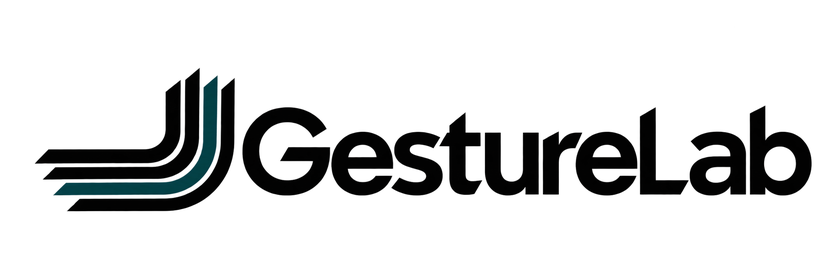

# Marca oficial do GestureLab

Os traços paralelos em curva representam posições sucessivas de um gesto captado pela câmera. A assinatura horizontal combina o símbolo em preto e azul-petróleo com o nome GestureLab.

- [Logo original em PNG transparente](gesturelab.png) para uso sobre fundos claros.
- [Versão sobre fundo branco](gesturelab-fundo-claro.png) para páginas com tema claro ou escuro.

Ao redimensionar, preserve as proporções do arquivo.
