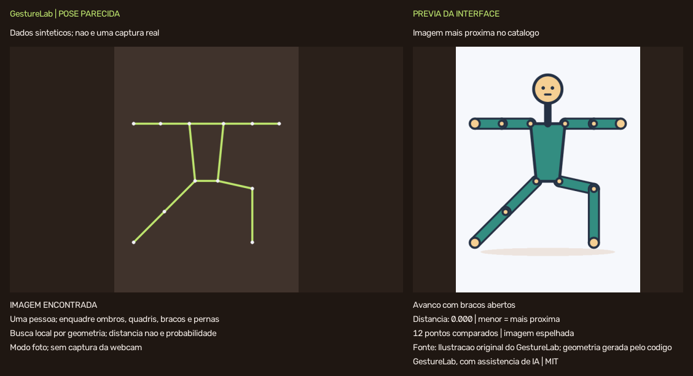

# PoseMatch — encontrar uma imagem com pose parecida

[Projeto](../../README.md) · [Catálogo e imagens](../../pose_gallery/README.md) ·
[Arquitetura](../ARQUITETURA.md) · [Testes](../../tests/README.md)

O modo `posematch` estima a pose corporal de uma pessoa, compara sua geometria
com as referências de um catálogo local e mostra a imagem mais próxima aceita
ao lado da câmera. Ele é independente do reconhecimento de gestos da mão e da
escrita no ar. A imagem recuperada já existe no catálogo; não é gerada a cada frame.



*Esta prévia usa pontos sintéticos e uma ilustração original. Não é uma captura
de webcam nem uma avaliação do detector.*

## Executar

Na raiz do projeto, depois de instalar `requirements.txt` no ambiente virtual:

```powershell
.\.venv\Scripts\python.exe scripts/download_models.py --only poses
.\.venv\Scripts\python.exe scripts/check_environment.py --imports --models poses
.\.venv\Scripts\python.exe app.py --mode posematch
```

Em macOS/Linux, substitua o executável por `.venv/bin/python`.

1. Posicione a câmera de forma que uma pessoa apareça no enquadramento.
2. Mantenha ombros, quadris, braços e pernas visíveis e experimente uma pose.
3. Sustente a pose brevemente; a referência aparece no painel da direita.
4. Observe título, distância e quantidade de articulações comparadas.
5. Use Q ou Esc com a janela em foco para encerrar.

O catálogo inicial contém ilustrações originais, com geometria conhecida.
Fotografias próprias podem ser indexadas com o script explicado abaixo. Uma
galeria maior e com posições variadas aumenta as opções disponíveis, mas não
garante que toda pose nova tenha uma referência adequada.

## Opções úteis

| Objetivo | Comando após o executável Python |
| --- | --- |
| Abrir com as referências incluídas | `app.py --mode posematch` |
| Usar outra câmera | `app.py --mode posematch --camera 1` |
| Exibir a captura sem espelhamento | `app.py --mode posematch --no-mirror` |
| Usar seu catálogo | `app.py --mode posematch --gallery data/minha_galeria/catalog.json` |
| Exigir maior proximidade | `app.py --mode posematch --match-threshold 0.5` |
| Processar uma foto | `app.py --mode posematch --image minha_pose.jpg` |
| Salvar a comparação de uma foto | `app.py --mode posematch --image minha_pose.jpg --output outputs/comparacao.png` |
| Verificar uma sequência sem janela | `app.py --mode posematch --headless --max-frames 30` |

As opções `--gallery` e `--match-threshold` pertencem somente a esse modo. A opção
`--num-hands` configura os modos de mãos; a busca corporal detecta até duas
pessoas para poder rejeitar a cena quando houver mais de uma.

O modo foto imprime um resumo JSON e não abre a webcam. A composição salva inclui
a foto de entrada e a referência, ao contrário do PNG da escrita no ar, que
contém somente tinta. `--output` exige `--image`, recusa um arquivo existente e
preserva o original. No modo webcam não há gravação automática de fotos/vídeos.

## Ampliar o catálogo com fotografias

Coloque fotos que você pode usar em `data/minhas_fotos`, preferindo uma pessoa
por imagem, corpo visível e poses variadas. Execute:

```powershell
.\.venv\Scripts\python.exe scripts/build_pose_catalog.py --input data/minhas_fotos --output data/minha_galeria
.\.venv\Scripts\python.exe app.py --mode posematch --gallery data/minha_galeria/catalog.json
```

O indexador utiliza o Pose Landmarker real e prepara as imagens e o catálogo em
uma pasta nova. Ele não atribui poses inventadas às fotos: imagens que não
produzirem uma pose utilizável são recusadas. Consulte o
[README do catálogo](../../pose_gallery/README.md) para o contrato completo,
origem das referências e opções de indexação.

`data/` já é ignorado pelo Git. Revise imagens, metadados e condições de uso antes
de publicar um catálogo próprio. O runtime pesquisa os arquivos fornecidos e
não consulta buscadores externos a partir dos frames da câmera.

## Como a comparação funciona

O detector corporal retorna 33 landmarks. O descritor usa 12 articulações:
ombros, cotovelos, punhos, quadris, joelhos e tornozelos.

1. Converte `x` e `y` normalizados para a proporção real da imagem. Isso evita
   comparar uma foto vertical e uma horizontal como se tivessem a mesma escala
   nos dois eixos.
2. Descarta articulações fora da imagem, não finitas ou com `visibility`/
   `presence` inferiores a 0,5. Ombros e quadris precisam estar presentes, com
   pelo menos oito articulações confiáveis no total.
3. Centraliza os pontos no meio dos quadris e divide pela escala do tronco. A
   escala considera o comprimento central/lateral do tronco e limites derivados
   da largura dos ombros/quadris, rejeitando uma geometria degenerada.
4. Calcula a raiz da média ponderada dos erros quadráticos entre articulações
   correspondentes, usando a menor confiança de cada par como peso. Exige pelo
   menos oito articulações confiáveis compartilhadas.
5. Compara também a referência refletida, com troca dos lados anatômicos, e
   conserva a hipótese de menor distância.
6. Ordena as referências e aceita somente distâncias dentro do limiar. O
   primeiro resultado é o mais próximo segundo esse descritor e esse catálogo.

**A distância não é uma porcentagem de acerto.** Zero significa coincidência
geométrica das articulações comparadas após a normalização. O limiar padrão
`0.8` é experimental e precisa ser avaliado nas suas imagens. Diminuí-lo exige
mais semelhança e pode resultar em mais cenas sem correspondência.

O descritor remove translação e escala uniforme. Ele preserva inclinação e
orientação no plano e não resolve automaticamente diferenças de perspectiva,
proporções corporais ou poses 3D que parecem iguais na projeção 2D. Rosto, roupa,
cor e fundo não entram na comparação.

## Espelhamento e continuidade da tela

A inferência usa o frame original. O espelhamento da câmera é aplicado somente
na apresentação. A referência também pode ser refletida para alinhar a pose
selecionada com o que aparece no painel da câmera; a tela identifica esse caso.

Na webcam, uma nova candidata precisa permanecer consistente por 180 ms
antes de ser exibida. Essa confirmação pertence à busca de imagens e não
altera o modo `gestures`. Perder a pessoa, detectar mais de uma, ficar sem pontos
suficientes ou sem candidata aceitável limpa a referência. O modo foto não usa
confirmação temporal.

Um intervalo maior que 750 ms entre frames reinicia a confirmação. Em um
computador que processe mais lentamente que isso, uma referência poderá não
chegar a aparecer; verifique o desempenho no equipamento usado antes de ajustar
esses parâmetros.

## Organização do código

| Arquivo | Responsabilidade |
| --- | --- |
| [app.py](../../app.py) | Validar a CLI e encaminhar o quarto modo |
| [pose_matching.py](../../pose_matching.py) | Descritor, distância, ranking e validação do catálogo, apenas biblioteca padrão |
| [pose_match_app.py](../../pose_match_app.py) | Modelo corporal, câmera/foto, seleção temporal e composição da interface |
| [vision_runtime.py](../../vision_runtime.py) | Dependências nomeadas e operações de imagem/câmera compartilhadas |
| [file_io.py](../../file_io.py) | Criar saídas sem sobrescrita, compartilhado com os modos existentes |
| [scripts/build_pose_catalog.py](../../scripts/build_pose_catalog.py) | Indexar fotos locais com o detector corporal |
| [pose_gallery](../../pose_gallery/README.md) | Imagens e landmarks das referências iniciais |

As dependências de visão são carregadas na execução, permitindo que ajuda e
testes de lógica funcionem sem câmera ou modelo. O núcleo geométrico não depende
da interface, e o catálogo pode ser ampliado sem mudar a implementação do ranking.

## Limites e avaliação

- O resultado é a referência mais próxima aceita dentro do catálogo carregado,
  não uma busca pela melhor imagem existente na internet.
- O detector estima anatomia humana. Animais, objetos e personagens muito
  estilizados podem não ser detectados pelo indexador. As ilustrações iniciais
  usam geometria conhecida na construção, identificada como tal.
- Uma pose parcialmente visível pode ser comparada usando menos articulações;
  a tela informa a quantidade e diferenças nos pontos ausentes não são avaliadas.
- O título da referência é um metadado do catálogo, não uma classificação
  universal do movimento da pessoa.
- Não há reconhecimento de identidade, julgamento de técnica esportiva nem
  análise clínica. O objetivo é recuperar imagens por configuração corporal.
- Testes sintéticos verificam contratos; correspondência com a própria imagem
  verifica integração. Nenhum desses procedimentos mede generalização para
  novas pessoas ou substitui o teste da webcam no equipamento de destino.

Para avaliar a qualidade, reserve fotos de pessoas ou sessões que não estejam
no catálogo, defina quais referências seriam aceitáveis e registre acertos,
rejeições e casos ambíguos. Compare diferentes limiares antes de fixar o escolhido,
mantendo uma avaliação final separada.

## Fontes

- [Pose Landmarker para Python](https://ai.google.dev/edge/mediapipe/solutions/vision/pose_landmarker/python)
- [Implementação oficial da tarefa](https://github.com/google-ai-edge/mediapipe/blob/master/mediapipe/tasks/python/vision/pose_landmarker.py)
- [Modelos e hashes usados no projeto](../../models/README.md)
